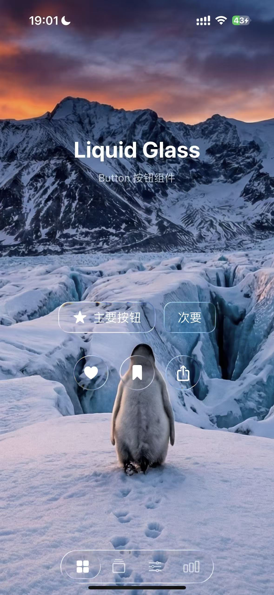

# LiquidGlassEffect

iOS 15+ 的 SwiftUI 液态玻璃效果库，使用 Metal 渲染背景折射、散射和边缘高光。视觉方向参考液态玻璃材质，**不是 Apple 原生 Liquid Glass 的移植或逐像素复刻**。

[](https://swift.org)
[](https://developer.apple.com/ios/)

> **集成边界：**背景捕获仍依赖私有 `CABackdropLayer`。本项目不承诺 App Store 审核通过，也不将最低部署版本声明等同于所有系统和设备的运行验证。许可证状态见文末。

## 3.0.0：光学与捕获链路重构

3.0.0 包含光学、捕获和边缘专项重构。现有 `.liquidGlass(...)`、`LiquidGlassGroup` 和 SwiftUI 组件的常用调用方式保持兼容；预设的实际外观有意重新校准。

- **边缘与主体分开采样：**原始背景用于清晰的折射边缘，独立的 Gaussian blur 纹理用于材质内部散射。模糊使用系统 `MPSImageGaussianBlur`，不在输入纹理上原地写入。
- **以 point 为单位的几何：**圆角 SDF、厚度和光学位移不再依赖控件的归一化高度；圆形、胶囊和宽面板使用同一坐标约定。
- **边缘 v2：**用紧致 Gaussian 高光唇替代宽泛的指数白尾，将约 1 point 深度的内暗谷独立计算；Fresnel 与方向高光只消耗一次反射混合预算。折射肩部通常限制在 2–5 point，主体散射保持独立深度，不再用同一个宽度同时决定边框与模糊。
- **阴影与裁剪：**玻璃表面不再叠加 `ShadowView` 环影，改由自身 layer 向外投影；容器只裁剪前景内容，不裁掉玻璃抗锯齿边缘和外部阴影。公开 `ShadowView` 类型与 `shadowOverlay` 参数仍保留，后者控制表面的外投影。
- **统一捕获坐标：**捕获矩形记录 window-space point 坐标，独立视图和分组视图通过同一映射计算 UV。捕获余量与放大倍率分开处理。
- **帧生命周期：**每次捕获持有对应的 `CVPixelBuffer`、`CVMetalTexture` 和纹理，直到使用该帧的 GPU command 完成。不是固定双缓冲槽位的循环覆盖。
- **分组捕获：**一个 `LiquidGlassGroup` 有一个背景捕获循环，子视图共享该帧、各自计算采样区域；同一帧同一 sigma 的模糊结果复用，但每个表面仍单独绘制。
- **实时配置：**SwiftUI 更新直接传入已有 `LiquidGlassView`，材质 tint、模糊、圆角和阴影等配置不需要通过 `.id(...)` 重建视图。
- **对照页与测试：**保留原五页组件画廊，新增 **Optics** 入口，提供网格、文字、动态背景以及独立/分组对照。

**当前边缘 v2 验证：**2026-10-14，Xcode 26.4 / iPhone 16 / iOS 18.4 Simulator 最终完整执行 **26/26 通过，0 失败、0 跳过**（23 项渲染/资源/阴影测试 + 3 项 UI 测试）。已检查组件画廊、浅色与深色分组的最终运行截图；外观仍由实际对照验收，不将测试通过视为原生逐像素一致。

**第一轮历史记录（2026-10-14，边缘 v2 之前）：**Xcode 26.4 / iPhone 16 / iOS 18.4 Simulator 从干净 DerivedData 执行，20 项测试通过（17 项渲染/资源测试 + 3 项 UI 测试，0 失败/跳过），并检查浅/深色及独立/分组截图。**该 20/20 记录不覆盖当前边缘 v2、外投影改动和新增 6 项回归。**最低部署要求仍为 iOS 15；其他 OS、真机、性能和发布渠道单独验证。复测：`./scripts/test-ios18.sh`。

详见 [光学架构与验证方法](docs/OPTICS.md)、[构建说明](BUILD)、[更新日志](CHANGELOG.md)。

## 效果展示

下面的素材来自仓库原有演示，**不是 3.0.0 重构的验收截图**。新效果请运行 Optics 对照页或检查对应测试结果中的截图。

| Button 按钮 | Card 卡片 | 原有动态演示 |
|:---:|:---:|:---:|
|  |  | [视频演示](docs/assets/demo_video.mp4) |

## 安装

### Swift Package Manager · 3.0.0

```swift
dependencies: [
    .package(url: "https://github.com/Lincb522/LiquidGlassEffect.git", from: "3.0.0")
]
```

Xcode 中添加仓库 URL，选择 **Up to Next Major Version / 3.0.0**。需要锁定本次发布时使用 `exact: "3.0.0"`。

**从 2.x 升级前请阅读 [迁移说明](docs/MIGRATING-3.0.md)**：底层 CGContext 回调坐标、按钮 action 时序和自定义光学参数存在行为变化，所以使用新的主版本；`from: "2.1.2"` 不会自动跨到 3.x。

### 本地开发

```swift
dependencies: [
    .package(path: "../LiquidGlassEffect")
]
```

示例工程引用上一级本地 package。

## 快速开始

```swift
import SwiftUI
import LiquidGlassEffect

struct ContentView: View {
    var body: some View {
        ZStack {
            Image("Backdrop")
                .resizable()
                .scaledToFill()

            Text("Hello, Liquid Glass!")
                .padding(.horizontal, 24)
                .padding(.vertical, 16)
                .liquidGlass(config: .regular, cornerRadius: 24)
        }
    }
}
```

材质需要背后有真实内容。只在纯色背景上观察一个半透明轮廓，不足以判断折射或背景捕获是否正确。

## 配置预设

```swift
.liquidGlass(config: .regular)   // 主体柔化，边缘保留较清晰折射
.liquidGlass(config: .lens)      // 不额外模糊的清晰透镜
.liquidGlass(config: .subtle)    // 更克制的边缘响应
.liquidGlass(config: .thumb())   // 小尺寸表面；支持 magnification
```

本次重新校准了预设的厚度、折射率、色散和高光。`.regular` 的默认模糊半径从 10 调整为 5 point，`.lens` 保持零额外模糊，但边缘模型已改变。**调用兼容不意味着外观不变。**已有产品应重新检查文字可读性、tint 和自定义参数，而不是直接沿用旧截图验收。

实时 tint 示例：

```swift
var uniforms = LiquidGlassConfig.regular.uniforms
uniforms.materialTint = SIMD4<Float>(0.12, 0.48, 0.94, 0.19)
let tinted = LiquidGlassConfig(
    uniforms: uniforms,
    textureSizeCoefficient: 1.1,
    textureScaleCoefficient: 1.0,
    blurRadius: 5
)
```

材质 tint 由 shader 参与混合，不是覆盖在玻璃之上的实色卡片。

## 分组与性能控制

```swift
LiquidGlassGroup {
    HStack {
        Text("Regular").padding().liquidGlass(config: .regular)
        Text("Lens").padding().liquidGlass(config: .lens)
    }
}

// 独立视图的背景捕获频率
Text("Lower capture rate")
    .padding()
    .liquidGlass(backgroundCaptureFrameRate: 15)

LiquidGlassEngine.shared.performanceMode = .efficiency
```

当前分组捕获循环固定请求 30 fps；每个子视图仍有自己的绘制和按配置执行的模糊工作。`.static` 是较低帧率模式，不是自动检测内容静止后停止所有 GPU 工作。捕获、绘制和显示帧率是不同指标。

本项目不提供未经测量的 CPU 降幅、GPU 零占用或固定延迟承诺。`LiquidGlassTexturePool` 的现有 API 仍保留，但新的捕获帧通过 Core Video pool 租借资源，不作为普通池纹理归还；现有普通纹理池是分桶和数量限制，不应描述为 LRU。

## 组件库

| 类别 | 组件 |
|---|---|
| 按钮 | `LiquidGlassButton`、`LiquidGlassTextButton`、`LiquidGlassIconButton` |
| 容器 | `LiquidGlassCard`、`LiquidGlassContainer` |
| 导航 | `LiquidGlassTabBar`、`LiquidGlassLabeledTabBar`、`LiquidGlassPillTabBar`、`LiquidGlassFloatingBar` |
| 表单 | `LiquidGlassTextField`、`LiquidGlassSecureField`、`LiquidGlassToggle`、`LiquidGlassLabeledToggle`、`LiquidGlassSlider`、`LiquidGlassHorizontalSlider` |
| 展示 | `LiquidGlassTag`、`LiquidGlassBadge`、`LiquidGlassNotification`、`LiquidGlassToast` |
| 进度 | `LiquidGlassProgress`、`LiquidGlassCircularProgress`、`LiquidGlassIndeterminateProgress` |

## 运行示例与测试

```bash
cd Example
xcodegen generate
open LiquidGlassDemo.xcodeproj
```

选择已安装的 iOS 18 模拟器。默认显示原有五页画廊；点击 **Optics**，或在 Run Arguments 中加入 `--optics` 直接进入光学对照页。

对照页提供 Motion、Dark、Blue tint、Tight corners、Grouped 和 Glass 六个开关。UI 测试保留截图附件；Metal 测试覆盖坐标映射、纹理方向、独立模糊纹理及捕获资源生命周期。边缘专项新增深灰底高光/白尾、白底内暗谷、2x/3x 点单位剖面、薄层连续折射四个 GPU 测试，另有两项阴影路径与更新测试。测试方法和运行记录应分开阅读：**存在测试代码不等于已通过目标系统验证**。

完整命令与验收步骤见 [Example README](Example/README.md) 和 [OPTICS](docs/OPTICS.md)。

## 限制

- 背景捕获使用私有 `CABackdropLayer` 与 `drawHierarchy`。系统版本、compositor 内容类型和运行环境可能改变捕获行为；没有 App Store 接受性保证。
- 当前为屏幕空间二维材质近似，不是完整的三维光线追踪，也不是 Apple 系统材质。背景、自定义 tint、控件大小和动态状态都影响观感。
- 视频、其他 Metal 图层、受保护内容、复杂 transform、多窗口和嵌套分组需分别做实际捕获验证；普通文字/网格测试不覆盖这些场景。
- 分组减少的是重复背景捕获。大面积共享纹理、每个子视图的模糊与绘制仍有成本，应在目标真机上量测。
- 缺失 Metal 或背景捕获失败会记录诊断；不会用一个静态渐变冒充正常玻璃。无可用帧时不发布新的画面，有旧帧时可能暂时保持旧内容。
- iOS 15 是声明的部署下限。本轮首先面向 iOS 18 模拟器；其他系统、真机、辅助功能及能耗验收仍需单独完成。

## 致谢

- [LiquidGlassKit](https://github.com/DnV1eX/LiquidGlassKit) by Alexey Demin：项目既有的 SDF/玻璃实现基础与署名来源。
- Apple Metal、Core Video、Metal Performance Shaders：系统渲染、纹理共享和 Gaussian blur 实现。

## 许可证状态

上游 README 声明 **MIT License**，但本次 checkout（以及取得的上游文件）没有根目录 `LICENSE` 正文。这里保留该事实，不补写或代替权利人签发许可证；发布或再分发前应取得并核对完整许可文本及依赖署名。
